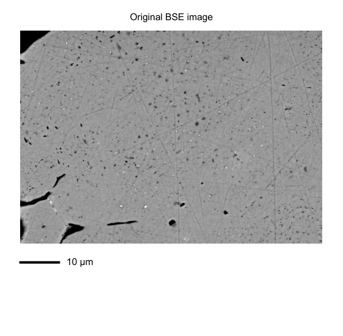
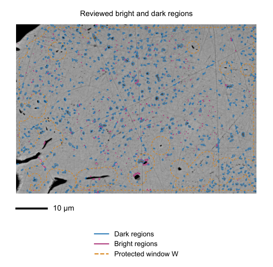
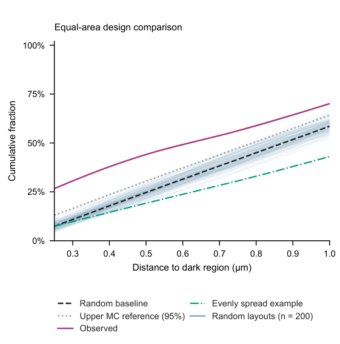
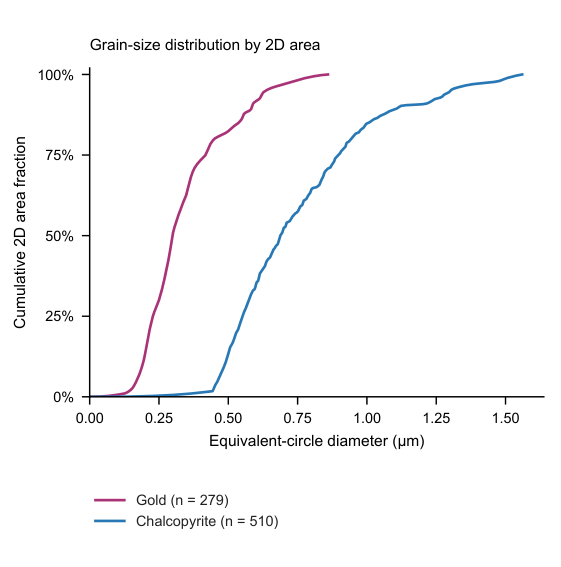

# EOH — Eyes of heaven

EOH is a Windows desktop application for BSE microscopy image review, grain-size measurements, and spatial comparisons with simulated particle layouts. The interface and generated reports are in English; the [Chinese user manual](EOH_%E4%B8%AD%E6%96%87%E8%AF%B4%E6%98%8E%E6%89%8B%E5%86%8C.html) provides a step-by-step guide.

## Download and start

1. Download `EOH_0.4.1_win64.zip` from the [latest EOH release](https://github.com/FisPrObXu/EOH/releases/tag/v0.4.1).
2. Extract the complete archive into a writable folder, for example `E:\EOH`.
3. Open `EOH/EOH.exe` with its accompanying `_internal` folder.

EOH runs on 64-bit Windows. The portable package includes the application runtime. Select **Auto (prefer GPU)**, **CPU only**, or **Prefer GPU (CPU fallback)** in the main window.

## What you can do

- Import and calibrate microscopy images, select a crop, and create bright and dark candidate regions.
- Review, add, redraw, and delete outlines in the local browser; mark buffered holes and cracks as exclusion areas.
- Compare observed distances with evenly spread layouts, random center layouts, and equal-area random layouts. The center model uses 4,999 Monte Carlo simulations.
- Plot grain-size distributions by particle count and measured 2D area, with D10, D50, and D90 tables.
- Group multiple fields under a sample ID, summarize cases and samples, and display sample-level bootstrap bands.
- Customize colors, labels, axes, legends, layouts, histograms, and the number of displayed random curves.
- Export individual PDF, SVG, PNG and TIFF figures, tables, simulation data, and reports.

## Example: one reviewed sample

These images show a single reviewed sample from image 6: the original image, its reviewed contours, an equal-area distance comparison, and its area-weighted grain-size distribution. The diagrams use the sample's recorded scale and review.

| Original image | Reviewed contours |
|:---:|:---:|
|  |  |
| **Equal-area distance comparison** | **Grain-size distribution by 2D area** |
|  |  |

## Typical workflow

1. Set **Input image folder** and **Output case folder**, then choose **1. Import image**. Crop and calibrate the image and create candidate outlines.
2. Open **2. Open review**, adjust outlines and exclusions, and select **Save all changes**.
3. Confirm the review and select **3. Generate report**. Use **Plot settings** to adjust the figures.
4. Check the cases to include, use **Set sample IDs for selected cases** to group fields by sample, and select **Export batch summary**. The same sample ID groups fields for sample-level summaries and resampling.

The count-weighted curve describes the fraction of measured regions; the area-weighted curve describes their cumulative 2D area. Sample-bootstrap bands use the declared sample groups. Equal-area random-move results are labelled as approximate descriptive comparisons, with sampling diagnostics recorded in the report.

## Source and licensing

The desktop source and default configuration are in [`comment1_colocation`](comment1_colocation). [BUILDING.md](BUILDING.md) describes the Windows build, and [SOURCE.md](SOURCE.md) lists corresponding source packages. EOH is distributed under [GNU AGPL-3.0-only](LICENSE); component licenses and attribution are in [THIRD_PARTY_NOTICES.md](THIRD_PARTY_NOTICES.md) and [`licenses/`](licenses/). Earlier thin-section tools are in [`src/eoh_thinsection`](src/eoh_thinsection).

---

# 中文说明

EOH 是用于 BSE 显微图像审核、粒径测量和随机布局空间对照的 Windows 桌面软件。界面与新生成的报告使用英文，操作步骤见[中文说明手册](EOH_%E4%B8%AD%E6%96%87%E8%AF%B4%E6%98%8E%E6%89%8B%E5%86%8C.html)。

## 下载与启动

1. 从 [EOH 发布页](https://github.com/FisPrObXu/EOH/releases/tag/v0.4.1)下载 `EOH_0.4.1_win64.zip`。
2. 将压缩包完整解压到可写文件夹，例如 `E:\EOH`。
3. 运行 `EOH/EOH.exe`，并保留同目录的 `_internal` 文件夹。

软件适用于 64 位 Windows，主窗口提供自动优先 GPU、CPU 和优先 GPU 三种计算设备选项。

## 主要功能

- 导入、裁切和定标显微图片，建立亮颗粒与暗区域候选轮廓。
- 在本机审核页新增、重画、删除轮廓，并设置孔洞和裂隙排除区。
- 对比实测距离、均匀铺开、中心位置随机布局和等面积随机布局；中心模型使用 4,999 次蒙特卡洛模拟。
- 按颗粒数量和二维面积展示累计粒径分布，输出 D10、D50、D90 等统计表。
- 使用样品 ID 对多张视野分组，生成逐案例、逐样品及汇总报告，展示样品级重抽样范围。
- 自定义颜色、图例、坐标、图幅、柱状图和随机曲线数量，导出 PDF、SVG、PNG、TIFF、表格与模拟数据。

## 样品分析案例

上方四张图片展示同一张已审核的样品 6：原图、审核轮廓、等面积距离对照和按二维面积加权的累计粒径曲线。

## 操作流程

1. 设置输入图片目录和输出案例目录，选择 **1. Import image**，裁切定标并生成候选轮廓。
2. 打开 **2. Open review**，调整轮廓和排除区，点击 **Save all changes**。
3. 确认审核后选择 **3. Generate report**，在 **Plot settings** 中调整图件。
4. 勾选案例，使用 **Set sample IDs for selected cases** 按样品分组，再选择 **Export batch summary**。同一 ID 下的视野共同参与该样品的统计与重抽样。

数量累计曲线表示给定粒径以下的颗粒占比；面积累计曲线表示给定粒径以下的累计二维面积比例。样品重抽样范围按照填写的样品分组计算。等面积随机移动结果以近似描述性对照展示，报告同时记录采样诊断。

## 源码与许可

桌面版源码与配置位于 [`comment1_colocation`](comment1_colocation)，构建步骤见 [BUILDING.md](BUILDING.md)，对应源码见 [SOURCE.md](SOURCE.md)。EOH 采用 [GNU AGPL-3.0-only](LICENSE)；第三方许可与署名见 [THIRD_PARTY_NOTICES.md](THIRD_PARTY_NOTICES.md) 和 [`licenses/`](licenses/)。薄片工具位于 [`src/eoh_thinsection`](src/eoh_thinsection)。
